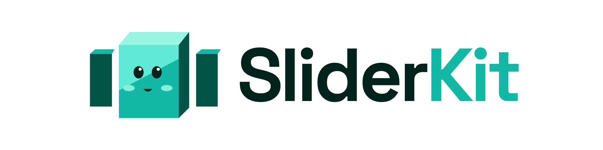

<p align="center">
  
</p>

# SliderKit

[](https://www.npmjs.com/package/@andresclua/sliderkit)
[](https://opensource.org/licenses/MIT)
[](https://github.com/sponsors/andresclua)

A modern, accessible, TypeScript-first slider library with WebGL effects, CSS transitions, and a rich plugin system.

**[Documentation & Demos →](https://sliderkit.andresclua.com)**

---

## Packages

| Package | Description | Size |
|---|---|---|
| [`@andresclua/sliderkit`](packages/core) | Core slider engine | ~7 KB gzip |
| [`@andresclua/sliderkit-plugins`](packages/plugins) | Arrows, pagination, autoplay, thumbs… | ~4 KB gzip |
| [`@andresclua/sliderkit-effects`](packages/effects) | CSS transition effects (fade, flip, clip-path…) | ~2 KB gzip |
| [`@andresclua/sliderkit-webgl`](packages/webgl) | GPU WebGL transitions (displacement, rgb-shift, radial) | ~4 KB gzip |

---

## Installation

```bash
# npm
npm install @andresclua/sliderkit

# pnpm
pnpm add @andresclua/sliderkit

# yarn
yarn add @andresclua/sliderkit
```

---

## Quick Start

```html
<div class="my-slider" id="my-slider">
  <div>Slide 1</div>
  <div>Slide 2</div>
  <div>Slide 3</div>
</div>
```

SliderKit wraps your element in `.sliderkit__outer > .sliderkit__overflow > .sliderkit__inner` and adds `.sliderkit` / `.sliderkit__item` classes. Import the base styles:

```typescript
import '@andresclua/sliderkit/scss/slider.scss'
import { Slider } from '@andresclua/sliderkit'

const slider = new Slider('#my-slider', {
  items: 1,
  loop:  true,
  speed: 400,
})

slider.on('indexChanged', ({ displayIndex }) => {
  console.log('Slide:', displayIndex)   // 1-based
})
```

---

## Options

### Layout

| Option | Type | Default | Description |
|---|---|---|---|
| `items` | `number` | `1` | Slides visible at once |
| `gutter` | `number` | `0` | Space between slides in px |
| `edgePadding` | `number` | `0` | Padding on the outer edges in px — makes adjacent slides peek |
| `fixedWidth` | `number \| false` | `false` | Fixed pixel width per slide, overrides `items` |
| `autoWidth` | `boolean` | `false` | Each slide uses its natural width |
| `viewportMax` | `number \| false` | `false` | Max viewport width used to compute clones with `fixedWidth` |
| `center` | `boolean` | `false` | Center the active slide |
| `axis` | `'horizontal' \| 'vertical'` | `'horizontal'` | Slide axis |
| `autoHeight` | `boolean` | `false` | Container height follows the visible slides |

### Behaviour

| Option | Type | Default | Description |
|---|---|---|---|
| `loop` | `boolean` | `true` | Infinite loop using DOM clones |
| `rewind` | `boolean` | `false` | Jump to first/last at the edges (forces `loop: false`) |
| `speed` | `number` | `300` | Transition duration in ms |
| `slideBy` | `number \| 'page'` | `1` | Slides advanced per next/prev |
| `startIndex` | `number` | `0` | Initial slide index |
| `freezable` | `boolean` | `true` | Freeze the slider when all slides fit |
| `preventActionWhenRunning` | `boolean` | `true` | Ignore next/prev/drag while a transition is running |
| `lazyload` | `boolean` | `false` | Wait for images before measuring |
| `arrowKeys` | `boolean` | `false` | Built-in ←/→ navigation on `document` (see the `keyboard()` plugin for a scoped version) |
| `onInit` | `(info) => void` | `false` | Called once the slider is ready |
| `plugins` | `SliderPlugin[]` | `[]` | Plugins to install |

### Touch & Drag

| Option | Type | Default | Description |
|---|---|---|---|
| `touch` | `boolean` | `true` | Touch swipe |
| `mouseDrag` | `boolean` | `false` | Mouse drag |
| `swipeAngle` | `number \| false` | `15` | Max angle (°) from the axis for a gesture to count as a swipe |
| `preventScrollOnTouch` | `'auto' \| 'force' \| false` | `false` | Block page scroll while swiping |

### Responsive

Any option above except `loop`, `rewind`, `startIndex` and `plugins` can change per breakpoint (`min-width`, in px). A bare number is shorthand for `{ items: n }`.

```typescript
new Slider('#my-slider', {
  items: 1,
  gutter: 8,
  responsive: {
    640:  { items: 2, gutter: 12 },
    1024: { items: 3, gutter: 20 },
    1440: 4,
  },
})
```

---

## Plugins

```bash
pnpm add @andresclua/sliderkit-plugins
```

```typescript
import { Slider } from '@andresclua/sliderkit'
import { arrows, pagination, autoplay } from '@andresclua/sliderkit-plugins'

new Slider('#my-slider', {
  plugins: [
    arrows(),
    pagination({ type: 'dots' }),
    autoplay({ delay: 3000, pauseOnHover: true }),
  ],
})
```

| Plugin | Options | Notes |
|---|---|---|
| `arrows()` | `prevText`, `nextText`, `container`, `wrapper` (default `true`) | Prev/next buttons. Wrapped in `.sliderkit__arrows`; hidden when all slides fit. |
| `pagination()` | `type: 'dots' \| 'fraction' \| 'progress'`, `clickable`, `container` | Rebuilt on breakpoint change. |
| `autoplay()` | `delay` (3000), `pauseOnHover`, `pauseOnFocus`, `direction: 'forward' \| 'backward'` | Also pauses while touching/dragging. |
| `thumbs()` | `container` (required), `activeClass` | Children of `container` become thumbnails. |
| `progress()` | `container` | Progress bar; mounted after the slider if no `container`. |
| `mouseWheel()` | `threshold` (120), `invert` | Calls `preventDefault` on wheel events over the slider. |
| `smooth()` | `preset` (`'smooth' \| 'snappy' \| 'floaty' \| 'free'`), `lerp`, `inertia`, `snap`, `maxFling`, `dragSpeed`, `wheel`, `wheelSpeed`, `snapDelay`, `dragThreshold`, `skew`, `onUpdate`, `raf` | Smooth drag + horizontal trackpad scroll with lerp, inertia and optional velocity skew. Use with `touch: false, mouseDrag: false`. |
| `keyboard()` | `focusable` (default `true`) | ←/→ (↑/↓ if vertical) when the slider has focus. |
| `a11y()` | `containerLabel`, `slideLabel` | Carousel roles/labels, and `tabindex="-1"` on focusable elements inside inactive slides. |
| `hooks()` | see below | Convenience callbacks, handy for GSAP. |

```typescript
hooks({
  onInit:       ({ slides, slider })                       => {},
  beforeChange: ({ outgoing, incoming, direction })        => {},   // direction: 'forward' | 'backward'
  afterChange:  ({ slide, direction })                     => {},
  onDragStart:  ({ event })                                => {},
  onDragEnd:    ({ event })                                => {},
  onResize:     ({ breakpoint, items })                    => {},   // fires on breakpoint change
  beforeDestroy: ()                                        => {},
})
```

### Smooth drag

`smooth()` replaces the core drag with a lerped position, inertia and horizontal trackpad scroll: the slider follows the pointer with a slight lag, keeps its momentum on release and settles on a slide.

```typescript
import { smooth, smoothPresets } from '@andresclua/sliderkit-plugins'

new Slider('#my-slider', {
  loop: true,
  touch: false, mouseDrag: false,            // smooth() replaces the core drag
  plugins: [smooth({ preset: 'snappy' })],   // 'smooth' | 'snappy' | 'floaty' | 'free'
})
```

Any option overrides its preset (`smooth({ preset: 'floaty', inertia: 1200 })`), and `smoothPresets` is a plain object you can spread. Skew the slides into the movement with `skew: true`, or build your own effect with `onUpdate`, which runs every frame the slider moves with the live state:

```typescript
smooth({
  onUpdate(sm) {
    sm.velocity      // slides per second, signed (0 at rest)
    sm.position      // position in slides
    sm.progress      // 0–1
    sm.positions[i]  // per real slide: 0 = start of the viewport, 1 = one slide further right
    sm.dragging
  },
})
```

Drawing on a canvas too? `smooth({ raf: false })` and call `sm.tick(now)` from your own `requestAnimationFrame`, so slider and canvas update in the same frame. Full reference: [docs](https://sliderkit.andresclua.com/docs/plugins/smooth) · [demos](https://sliderkit.andresclua.com/demos/smooth).

---

## Events

```typescript
slider.on('indexChanged', ({ displayIndex }) => {})
```

`beforeInit` · `afterInit` · `indexChanged` · `transitionStart` · `transitionEnd` · `touchStart` · `touchMove` · `touchEnd` · `dragStart` · `dragMove` · `dragEnd` · `resize` · `newBreakpointStart` · `newBreakpointEnd` · `beforeDestroy` · `afterDestroy`

Handlers receive a `SliderInfo` (`index`, `displayIndex`, `slideCount`, `items`, `cloneCount`, `event`, …).

---

## Methods & properties

```typescript
slider.goTo(2)            // 0-based real index
slider.goTo('next')       // 'next' | 'prev' | 'first' | 'last'
slider.next()
slider.prev()

slider.getInfo()          // SliderInfo
slider.on('event', fn)
slider.off('event', fn)
slider.destroy()          // restores the original DOM

slider.activeIndex        // 0-based real index (no clones)
slider.slideCount
slider.currentItems       // items for the current breakpoint
slider.isBeginning / slider.isEnd
```

---

## CSS Effects

```bash
pnpm add @andresclua/sliderkit-effects
```

```typescript
import { Slider } from '@andresclua/sliderkit'
import { fadeEffect } from '@andresclua/sliderkit-effects'

new Slider('#my-slider', {
  items:   1,
  plugins: [fadeEffect({ duration: 600 })],
})
```

Available effects: `fadeEffect`, `flipEffect`, `clipPathEffect`.

---

## WebGL

```bash
pnpm add @andresclua/sliderkit-webgl
```

```typescript
import { Slider } from '@andresclua/sliderkit'
import { arrows } from '@andresclua/sliderkit-plugins'
import { webgl, preloadWebGL } from '@andresclua/sliderkit-webgl'

const assets = await preloadWebGL({
  slides:       [1,2,3,4,5].map(i => `/images/slide-${i}.jpg`),
  displacement: '/images/displacement.png',
})

new Slider('#my-slider', {
  items:   1,
  loop:    true,
  speed:   0,
  plugins: [arrows(), webgl({ effect: 'displacement', assets })],
})
```

Options: `effect` (`'displacement' | 'rgb-shift' | 'radial' | 'custom'`), `assets`, `duration` (900), `intensity` (0.08), `easing`, and for `custom`: `frag` (GLSL) + `uniforms`.

> **Note:** Use `items: 1` and `speed: 0` with the WebGL plugin. It silently no-ops when WebGL is unavailable.

---

## GSAP Integration

SliderKit events wire directly into GSAP — no adapter needed:

```typescript
import { Slider } from '@andresclua/sliderkit'
import { gsap } from 'gsap'

const slider = new Slider('#my-slider', { loop: true })

slider.on('indexChanged', ({ displayIndex }) => {
  const slide = slider.getInfo().slideItems[displayIndex - 1]
  gsap.fromTo(slide, { x: 40, opacity: 0 }, { x: 0, opacity: 1, duration: 0.4 })
})
```

---

## Development

```bash
# Install dependencies
pnpm install

# Build all packages
pnpm build

# Start playground dev server
pnpm dev

# Start docs dev server
pnpm docs
# then open http://localhost:4321
```

---

## Support this project

If SliderKit is useful to you, consider [sponsoring the development](https://github.com/sponsors/andresclua).

## Author

**Andrés Clúa** — frontend developer based in Barcelona.

- GitHub: [@andresclua](https://github.com/andresclua)
- Web: [andresclua.com](https://andresclua.com)

## License

MIT © [Andres Clua](https://github.com/andresclua)
